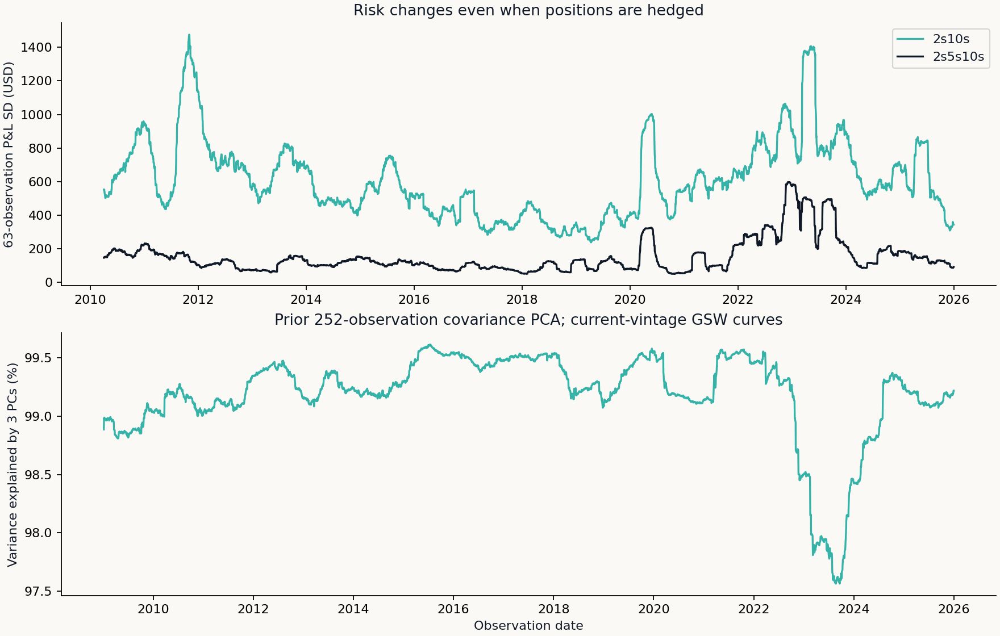

# Macro Rates Research

**What is priced into the policy path—and what risks remain when a trade is hedged?**

This research connects policy calendars, monthly-rate contracts and Treasury curve risk. It grew from questions raised in Global Macro Investing, then reconstructs the methods in an independent public implementation. The objective is to make a rates view precise enough to test, price and challenge.

[Methods](docs/METHODS.md) · [Curve results](reports/curve/REPORT.md) · [Policy demonstration](reports/demo/REPORT.md) · [Verification](docs/VERIFICATION.md) · [Data rights](docs/DATA.md) · [Portfolio](https://github.com/Mingju-Zhang-CBS/Quant)

## A result worth examining

The real-data curve study contains **4,000 daily model observations per portfolio, 2010–2025**. With USD 1m gross model market value reset each observation, the DV01-matched 2s10s position had a worst daily model P&L of **−$3,074**. The three-leg position neutralizing two prior PCA exposures still had a worst day of **−$2,095**. These are hypothetical zero-coupon risk calculations on current-vintage Federal Reserve curves, **not executable bond returns or account NAVs**.



The useful finding is that hedge labels do not remove losses. Parallel-duration neutrality leaves nonparallel moves and convexity; PCA neutrality depends on the estimation window and chosen universe. [Read the attribution and limitations](reports/curve/REPORT.md).

## Two connected studies

| Study | Research implementation | Skills demonstrated |
|---|---|---|
| Policy path and calendar trades | Calendar-day monthly EFFR averaging; effective-date changes; declared scenarios; grid rounding; two-leg cash and reserve accounting | Contract conventions, policy exposure, cost breakeven and funding risk |
| Treasury curve risk | Svensson zero curves; aging and full repricing; DV01 matching; covariance PCA fitted only on prior changes; Taylor and factor attribution | Fixed-income mathematics, numerical checks, risk decomposition and temporal discipline |

**Evidence status.** Curve results use real public data. The offline policy demonstration is synthetic. A separate licensed historical-contract workflow is available, but vendor unit evidence, original publication timing and redistribution rights remain open; its actual records and derived findings stay private. These evidence levels are intentionally distinct.

## Run the research

Python 3.12; CPU only; no broker connection or API key is needed for the demonstration.

```bash
python -m pip install '.[test]'
python -m pytest
python -m macro_rates --demo --output output/demo
```

For the public-data curve report, download the [official GSW CSV](https://www.federalreserve.gov/data/yield-curve-tables/feds200628.csv), then:

```bash
python -m macro_rates --gsw /path/to/feds200628.csv --output output/curve
```

The saved report records the exact source fingerprint. A later download may differ because the source revises history. No trading claim follows from simply shifting revised data by a day.

## What the model does—and where it ends

Fed Funds futures settle against a monthly average, so meeting timing changes exposure. Market-implied averages contain premia and do not uniquely identify physical meeting probabilities. Treasury model curves are not Treasury futures: delivery options, CTD changes, conversion factors and basis require their own evidence. Missing historical margin is represented by a named proxy, never presented as observed SPAN.

Project direction and research choices: Mingju Zhang. Implementation, testing and documentation were developed with AI assistance. Public code was reconstructed for this study; course submissions, group originals, Bloomberg captures and employer materials are excluded. MIT covers original code; source data retain their own terms. [Attribution and sources](docs/DATA.md).
