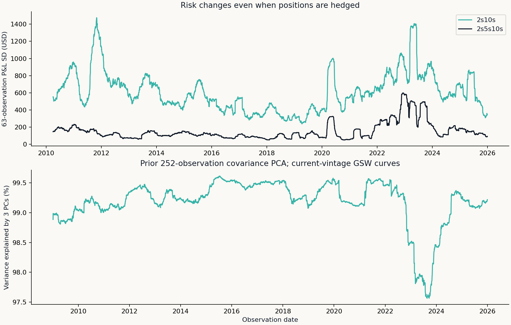

# Macro Rates Research

What risk remains after hedging a Treasury curve position, and how does policy timing affect a monthly Fed Funds contract? The research uses public Treasury research curves for risk attribution and synthetic contract scenarios for policy, execution and funding mechanics.

**Finding.** Over 4,000 daily model observations per portfolio in 2010–2025, the DV01-matched 2s10s position's worst daily P&L was **−$3,074**. A three-leg position neutralizing two prior PCA exposures still lost **$2,095** on its worst day. These are hypothetical zero-coupon positions on current-vintage Federal Reserve GSW staff curves.

[Curve results](reports/curve/REPORT.md) · [Policy demonstration](reports/demo/REPORT.md) · [Run the study](#run-the-study)



*Public GSW curves, 2010–2025. Daily repricing uses USD 1 million gross model market value reset each observation. The top panel shows 63-observation P&L volatility in dollars. The bottom panel shows the variance explained by three prior-window principal components. Hedge exposures and residual risk are detailed in the [attribution report](reports/curve/REPORT.md).*

## From policy views to funded positions

- **Curve risk.** Svensson zero curves drive aging and full repricing. Parallel-duration matching leaves nonparallel changes and convexity. PCA uses only prior changes and depends on the estimation window and curve universe.
- **Policy calendars.** Monthly contracts use a calendar-day average of EFFR. Meeting effective dates change the weights. The synthetic demo makes rounding, two-leg costs and collateral proxies explicit. A market-implied average includes premia and does not uniquely identify physical policy probabilities.
- **Evidence boundaries.** The public curve history is current vintage. Policy scenarios are synthetic. The separately documented licensed contract workflow depends on historical timestamp, unit and data-rights evidence.

[Methods](docs/METHODS.md) · [Verification](docs/VERIFICATION.md) · [Sources and data rights](docs/DATA.md)

## Run the study

Use Python 3.12 from the repository root. Activate the virtual environment with `.venv\Scripts\Activate.ps1` in PowerShell or `source .venv/bin/activate` on macOS/Linux.

```bash
python -m venv .venv
# Activate the environment before installing.
python -m pip install -r requirements.lock.txt
python -m pip install --no-deps -e .
python -m pip check
python -m pytest -q tests
python -m macro_rates --demo --output output/demo
```

The synthetic policy demo runs offline after installation. To run the curve attribution, download the [official GSW CSV](https://www.federalreserve.gov/data/yield-curve-tables/feds200628.csv) to the repository root, then use:

```bash
python -m macro_rates --gsw feds200628.csv --output output/curve
```

The saved report records the input fingerprint. A later download may reflect source revisions. Treasury futures delivery, basis and live execution are separate questions.

Research direction by Mingju Zhang, motivated by Global Macro Investing. The independent public implementation, tests and documentation were developed with AI assistance. [Sources and contribution](docs/DATA.md) · [MIT license](LICENSE) · [Research directory](https://github.com/Mingju-Zhang-CBS/Quant)
