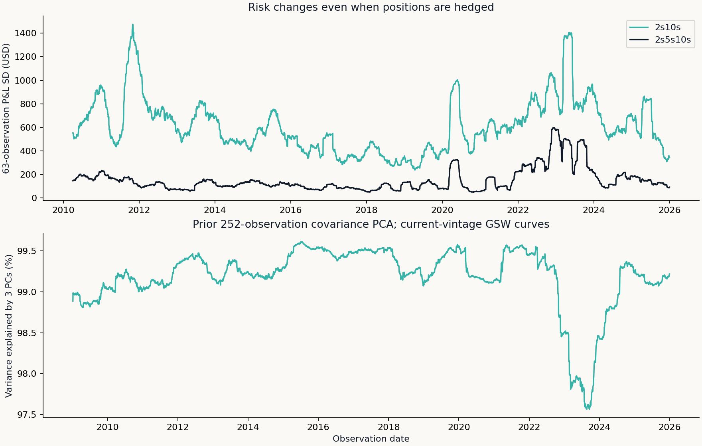
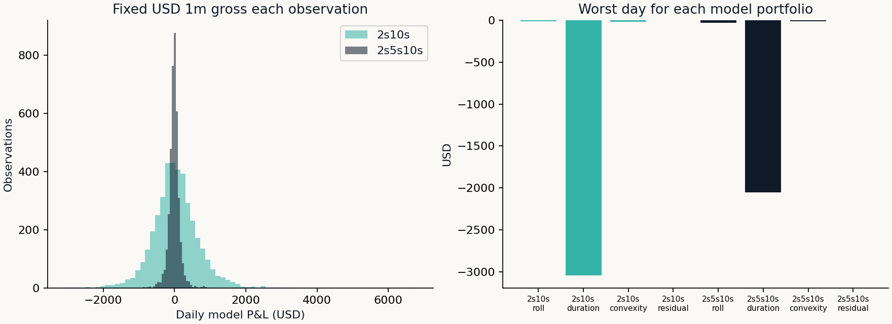

# Treasury Curve Risk: Results

Current-vintage Federal Reserve GSW staff research curves; hypothetical zero-coupon positions. This is retrospective risk attribution, not an investable return backtest.

```csv
portfolio,days,mean_model_pnl_usd,mean_block95_low,mean_block95_high,daily_pnl_sd_usd,worst_day_usd,mean_abs_taylor_residual_usd,mean_abs_pca_residual_usd,max_abs_net_dv01_usd_bp
2s10s,4000,26.395,4.086,45.298,650.613,-3074.299,0.086,75.88,0.0
2s5s10s,4000,-13.743,-18.724,-8.047,183.273,-2094.971,0.017,93.316,103.993
```





## Reading the result

The two-leg portfolio offsets parallel dollar duration at inception. The three-leg portfolio offsets the first two prior-window PCA exposures; those components do not have fixed economic meanings. Neither construction removes convexity, changing factor loadings or residual curve risk. The P&L distribution includes unfavorable days. Mean intervals use 1,000 moving-block resamples of 20 observations, seed 20261030. These describe this model experiment, not a funded strategy or selection-adjusted trading edge. Higher mean model P&L does not establish alpha.

## Accounting and limitations

Each observation resets gross model market value to USD 1m. Positions age by actual elapsed calendar days / 365.25, then reprice on the next curve. No cumulative account NAV, executable bond price, financing or transaction-cost claim is made. PCA uses the prior 252 changes ending before the observation date. GSW observations are revised and published with delay; lagged fitting alone does not make this historical snapshot point-in-time.

Source: [Federal Reserve GSW](https://www.federalreserve.gov/data/nominal-yield-curve.htm). Zero yields are continuously compounded; par yields are not used as zero rates.
