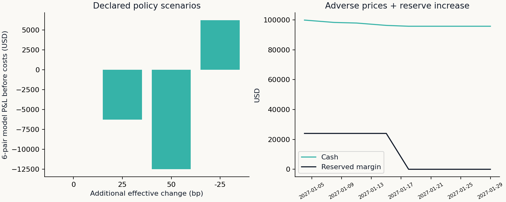

# Offline Policy and Funding Demonstration

All marks and reserve changes here are synthetic. Six pairs have USD 250.02 of relative monthly-rate bp exposure. The reserve jump can force an exit even with positive cash. The ledger distinguishes reserved collateral from an expense, and reconciles variation, interest and execution costs. A modeled forced exit does not guarantee that an actual market provides a fill.
